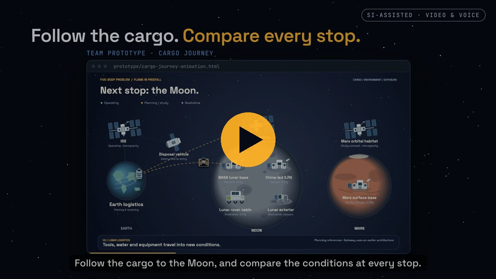

# 🛂 Cargo Passport

### Know what flies.

**A passport for space cargo: what it's made of, which NASA fire experiments apply where it's going, and what is still untested.**

NASA Space Apps Challenge 2026 · **Flame in Freefall** · Vienna 🇦🇹 · Team **Five-Body Problem**

---

## 🎬 Watch the 30-second video

▶️ [Play the video](media/cargo-passport-video.mp4) (MP4, 30 s, English subtitles)

---

## 💡 The problem

You need a passport to travel. So does your cargo in space.

Flames behave differently in microgravity: hot gases don't rise, so oxygen, airflow and materials decide how a fire spreads. NASA has run hundreds of combustion experiments, but each one holds only **for the conditions it was tested in**. A storage bag tested on the ISS at 21% O₂ tells you little about a lunar habitat at 30% O₂ and 1/6 g.

Today that gap is invisible to the crew who pack, ship and store the cargo.

## ✨ What Cargo Passport does

| | |
|---|---|
| 🧾 **A passport for every shipment** | Each item and the materials it's made of, behind one QR code. |
| 🛰️ **Follow the journey** | Earth → ISS → Moon: compare oxygen, pressure and gravity at every stop. |
| 🔬 **See what NASA tested** | Matches each material to NASA PSI experiments (BASS-II, Saffire, …). |
| 🧠 **SI assesses the evidence** | Explains what applies, with sources, and flags what is untested. No invented results. |
| 🚩 **Gaps stay visible** | "Conditions differ" and "no evidence" are shown, never hidden behind a score. |

## ⚙️ How it works

1. **Evidence** · NASA space experiments, drop-tower tests and MAPTIS material data.
2. **SI assesses** · compares test conditions with the cargo's real journey and explains the findings with sources.
3. **People decide** · how to ship, where to store, what to test next.

> SI assesses the evidence. **People make the call.**

## 👩‍🚀 Who it's for

- **Astronauts and cargo crews** packing, moving and storing items
- **Payload engineers** preparing an item for a new destination
- **Safety reviewers** who need the evidence and its limits in one place

## 🌍 Same method on Earth

**Variables change, processes stay.** Wherever an item moves into new conditions, the same question applies:

✈️ Aircraft cargo holds · ⚓ Submarines · 🔋 Battery storage · 🏫 Schools

NASA's own PSI records name submarines, high-altitude aircraft and better smoke detectors as Earth benefits of this research.

## 🗺️ Roadmap

1. Combine evidences (PSI, drop-tower & MAPTIS)
2. Flag risky routes & storage spots
3. Predict flame spread
4. Link fire-response steps
5. Extend to Moon & Mars

## 📚 Data sources

- **[NASA Physical Sciences Informatics (PSI)](https://psi.nasa.gov/physci/repo/search?q=combustion)**: BASS, BASS-II, Saffire-I–III, FLEX, SAME and more
- **Drop-tower experiments**: NASA BASS ground tests, [ZARM Bremen flame-spread dataset](https://zenodo.org/records/18479713)
- **Materials**: [NASA MAPTIS](https://maptis.nasa.gov/) and NASA-STD-6001 (planned; access requires registration)

> ⚠️ **Not a safety verdict.** Cargo Passport organises evidence for review. It does not approve cargo for flight; that remains with the responsible safety authority. The shipment in the video is illustrative.

## 👥 Team Five-Body Problem

Roman Slysh · Roman Ganopolskyi · Ivan Kotelnikov · Gjergj Brestovci · Sophie Ganopolska

Built in Vienna at NASA Space Apps Challenge 2026.

## 🤖 SI disclosure

The video narration is synthetic speech (Kokoro-82M TTS). The video visuals, music and the images in this README were produced with SI assistance. Every video frame carries a visible "SI-assisted" watermark.

## 📄 License

[MIT](LICENSE)
